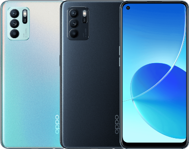

# FRP Bypass for Oppo Reno6 Z 5G (Clone Phone Method)

 

> [!WARNING]
> **Disclaimer:** Use these steps only on devices you own. Unauthorized bypassing of security features is illegal.

## What You Need
- Two phones
- Wi-Fi connection

---

## Steps

**1. Enter EngineerMode**
- Connect to Wi-Fi
- Go Back to Select Language screen
- Emergency call → `*#899#`

**2. Open Chrome**
- EngineerMode → manual test → CAMERA → camera test
- Snap a picture and open that picture → Share → Google Search Image
- Top right menu → Privacy Policy → use without account → click on any video → Chrome browser will open

**3. Open Settings app**
- In Chrome, go to https://azimstech.github.io/intent/ → Tap Open Settings

**4. Launch Clone Phone**
- **Settings → Home screen & Lock screen → Home screen layout**
- Open **Clone Phone** app from home screen

**5. Transfer Data**
- Tap **Agree → New phone → Import from Android**
- On second phone: Install **Clone Phone** → Scan QR code
- Complete transfer process

**6. Finish**
- FRP lock removed, Safe to Factory reset the device

---

> [!NOTE]
> Tested on OPPO Reno6 Z 5G (CPH2237) (20 Nov 2026)
